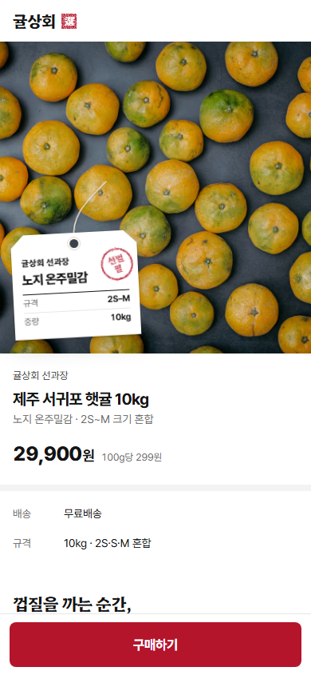
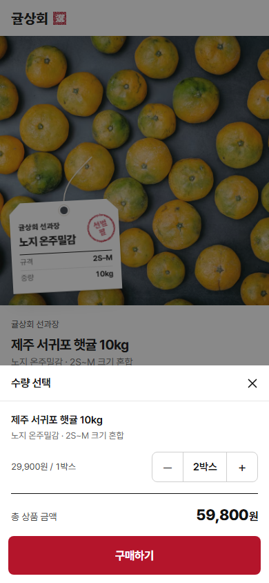

# 귤상회

카카오톡 프로필 링크로 여는 짧은 가상 감귤 상점 체험입니다. 상품을 보고 구매하기를 눌러 보세요.

비상업 개인 프로젝트입니다. 실제 판매·결제·회원가입은 없고, 입력 폼·서버 기능·분석 도구·런타임 외부 요청도 없습니다.

| 상품 | 수량 선택 |
|---|---|
|  |  |

## 기술 스택

- Next.js 16 (App Router, 정적 페이지), React 19, TypeScript
- Tailwind CSS 4
- 글꼴: Pretendard, Hahmlet (SIL OFL 1.1, 자체 호스팅)
- 테스트: Node 내장 test runner(단위), Playwright(흐름·시각 회귀·레이아웃·메타), axe-core(접근성)

## 로컬 실행

Node 24가 필요합니다.

```bash
npm ci
npm run dev          # http://localhost:3000
```

## 테스트

```bash
npx playwright install chromium webkit
npm run lint
npm test             # 단위 → 프로덕션 빌드 → E2E(390px·360px·WebKit)
```

성능 테스트(`tests/perf.spec.ts`, 기준 LCP ≤ 2.5초·INP ≤ 200ms·CLS ≤ 0.1)는 GitHub 러너의 `perf` 워크플로에서 판정하고, 로컬 `npm test`에서는 건너뜁니다. 로컬 PC는 측정값이 크게 흔들리기 때문입니다([`docs/AUDIT.md`](docs/AUDIT.md) 'PERF-1 측정 신뢰성'). 로컬에서 참고로 재려면 `PERF=1 npx playwright test tests/perf.spec.ts --project=m390`을 실행합니다.

## 문서

`docs/` 문서에는 체험의 결말이 들어 있습니다. 직접 해 보기 전이라면 나중에 읽어 주세요.

- [`docs/PROJECT.md`](docs/PROJECT.md) 요구사항과 결정 기록
- [`docs/DESIGN.md`](docs/DESIGN.md) 디자인 기준
- [`docs/PLAN.md`](docs/PLAN.md) 구현 계획과 승인 단계
- [`docs/TEST_PLAN.md`](docs/TEST_PLAN.md) 테스트 계획
- [`docs/AUDIT.md`](docs/AUDIT.md) 결함과 감사 기록
- [`docs/ASSETS.md`](docs/ASSETS.md) 사진 출처(Unsplash, 임시 사진)와 글꼴 라이선스
